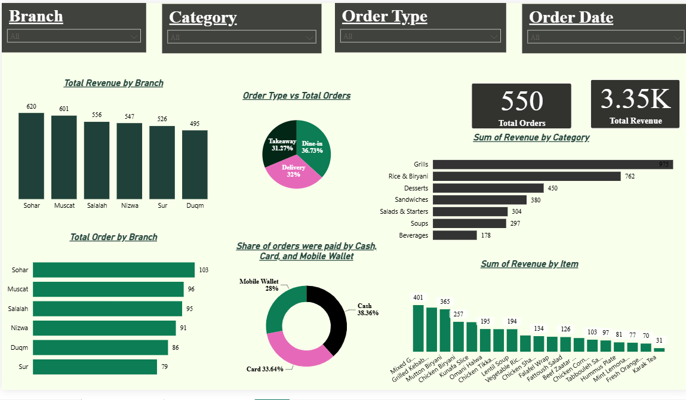
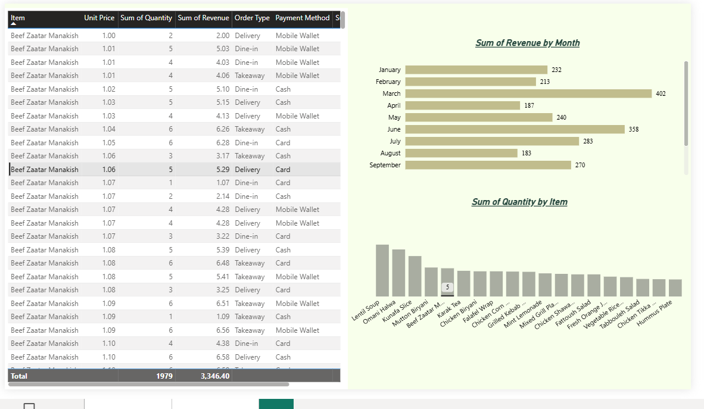

# Oman Bites — Excel & Power BI Sales Analytics Dashboard

A portfolio project demonstrating a restaurant analytics workflow for a simulated multi-branch business in Oman, using Excel, Power Query, Power Pivot, DAX, and Power BI.



## Project overview

- **Business scenario:** Restaurant operations in Oman
- **Tools:** Excel, Power Query, Power Pivot, DAX, Power BI
- **Source workbooks:** Raw data and cleaned data
- **Report:** `powerbi/Oman_Bites_Dashboard.pbix`
- **Analysis areas:** Branch revenue, order types, payment methods, products/categories, ratings, and quantities

## Dashboard preview



More examples: [revenue by branch](screenshots/insights/revenue-by-branch.png), [orders by branch](screenshots/insights/orders-by-branch.png), [slicers and filters](screenshots/dashboard/slicers-and-filters.png), and [highest-rated branch](screenshots/insights/highest-rated-branch.png).

## Repository structure

| Folder | Contents |
|---|---|
| `data/raw/` | Original source workbook |
| `data/processed/` | Cleaned workbook used with the dashboard |
| `powerbi/` | Power BI report |
| `docs/guides/` | Power Query cleaning notes |
| `docs/` | Project structure and audit notes |
| `screenshots/dashboard/` | Dashboard views and filters |
| `screenshots/data-cleaning/` | Data-cleaning evidence |
| `screenshots/data-model/measures/` | DAX and measures evidence |
| `screenshots/insights/` | Branch and restaurant insights |
| `scripts/` | Reproducible audit script |
| `reports/` | Data-quality and lineage audit outputs |

## Data lineage — important limitation

The raw workbook and cleaned workbook do **not currently reconcile as a full row-for-row transformation**:

- `Raw_Data.xlsx` contains 1,184 worksheet rows below its header, including 6 blank rows and 3 repeated-header rows.
- After excluding those blank/header rows, 1,175 candidate transaction rows remain. The source has duplicate order IDs and 31 negative-quantity rows, among other inconsistencies.
- `Oman_Bites_Cleaned_Data.xlsx` contains 550 rows in its `Cleaned Table` sheet.
- Only 519 unique order IDs overlap between the raw candidate rows and cleaned table: 631 unique raw IDs are absent from the cleaned table, and 31 cleaned IDs do not appear in the raw candidate set.

**Interpretation:** The processed workbook may be a filtered sample or may have been produced from a different source version. Do not describe it as a complete clean-up of the current raw workbook until the missing IDs and extra IDs are explained.

The cleaned workbook's Power Pivot summary reports 550 orders, total revenue of **OMR 3,346.403**, average order value of **OMR 6.084369**, and average rating of **3.672727**. Its branch pivot totals sum to the same OMR 3,346.403. These are internal workbook-summary checks; the audit script below performs a row-level reconciliation when run against both files.

## Audit files

- [Data lineage and quality audit](docs/data-lineage-audit.md)
- [Machine-readable audit](reports/data-lineage-audit.json)
- [Data-quality summary](reports/data-quality-summary.csv)
- [Branch revenue summary](reports/branch-revenue-reconciliation.csv)
- [Reproducible audit script](scripts/audit_oman_bites.py)
- [Project structure guide](docs/project-structure.md)

## Run the audit locally

Requires Python 3.10+ and uses the standard library only:

```bash
python scripts/audit_oman_bites.py
```

Optional custom paths:

```bash
python scripts/audit_oman_bites.py --raw data/raw/Raw_Data.xlsx --processed data/processed/Oman_Bites_Cleaned_Data.xlsx --output-dir reports
```

The script reads the workbooks and writes audit reports; it does not change the Excel files or the Power BI report.

## Recommendations

1. Reconcile the 631 missing raw IDs and 31 cleaned-only IDs before claiming end-to-end lineage.
2. Define whether the cleaned workbook should retain 1,150 unique source orders or intentionally filter to a documented 550-row subset.
3. Compare row-level revenue and average rating against Power Pivot measures after the lineage issue is resolved.
4. Preserve the raw file, retain Power Query Applied Steps, and document exclusions and business rules.
5. Label all results as simulated portfolio analysis rather than actual restaurant performance.

## Skills demonstrated

Excel, Power Query, Power Pivot, DAX, Power BI, data cleaning, data lineage, data-quality validation, KPI reconciliation, and business reporting.
